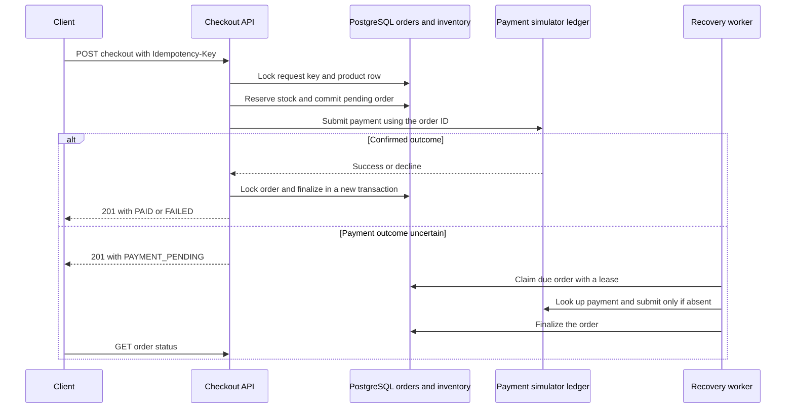

# Resilient Checkout API

**A checkout API that keeps orders and inventory consistent when customers retry, compete for the last item, or lose a payment response.**

The easiest way to see it work is to simulate a charge whose response never reaches checkout. The order starts as `PAYMENT_PENDING`, then the recovery worker finds the recorded charge and marks it `PAID` with the original payment reference. Payments are simulated, so the demo needs no payment account or API keys.

**Java 21 · Spring Boot · PostgreSQL · Flyway · Spring Security · Resilience4j**

The test suite verifies concurrent checkout, stock restoration, and payment recovery against PostgreSQL.

[Quick start](#quick-start) · [Manual tests](#manual-tests) · [Automated tests](#automated-tests) · [Architecture](#architecture) · [API](#api-at-a-glance) · [Teardown and data management](#teardown-and-data-management)

## Quick start

### 1. Clone and start the environment

Start Docker with the Compose plugin, then run these commands in a terminal. Compose builds the API, starts PostgreSQL, runs database migrations, and seeds a demo laptop and keyboard. Install Java 21 if you want to run the test suite locally or start the API directly. The Maven wrapper supplies Maven.

```bash
git clone https://github.com/adocxwork/resilient-checkout-api.git
cd resilient-checkout-api
docker compose up --build --wait
```

### 2. Check that the API is ready

```bash
curl -fsS http://127.0.0.1:8080/actuator/health/readiness
```

**Expected** `{"status":"UP"}`. If startup fails, check `docker compose ps` and `docker compose logs api postgres`.

<details>
<summary>Run the API directly with Java 21</summary>

Start only PostgreSQL, then start the API with the demo profile. Use this option when port 8080 is free.

```bash
docker compose up -d --wait postgres
./mvnw spring-boot:run -Dspring-boot.run.profiles=demo
```

You can also run `java -jar target/checkout-api.jar --spring.profiles.active=demo` after Maven `verify`. Use `mvnw.cmd` on Windows and install `unzip` for the Maven wrapper on Unix.

</details>

## Manual tests

Open a second terminal and run the blocks below in order in the same shell. They use `curl` and Bash-compatible syntax. The supplied credentials are for the local demo.

```bash
BASE=http://127.0.0.1:8080
AUTH=alice:alice-local-demo
PRODUCT_ID=1
RUN_ID="demo-$(date +%s)-$$"

curl -fsS -w '\n' -u "$AUTH" "$BASE/api/products"
```

On a fresh database, product `1` is the demo laptop and starts with **50 units**. If you’re reusing an older database, find the ID for `DEMO-LAPTOP` in the catalog response and update `PRODUCT_ID`.

### A. Place an order

```bash
BODY="{\"productId\":$PRODUCT_ID,\"quantity\":1}"

curl -i -u "$AUTH" -H 'Content-Type: application/json' \
  -H "Idempotency-Key: $RUN_ID-checkout" \
  --data "$BODY" "$BASE/api/orders"
```

**Expected** `201 Created`, a `Location` header, and a response with `status: PAID`. The catalog shows one fewer unit.

### B. Replay the same request

Send the same body and key as Test A.

```bash
curl -i -u "$AUTH" -H 'Content-Type: application/json' \
  -H "Idempotency-Key: $RUN_ID-checkout" \
  --data "$BODY" "$BASE/api/orders"
```

**Expected** `200 OK` with the original order ID and payment reference. There is no second stock deduction. If you change the quantity and keep that same key, expect `409 Conflict`.

### C. Request more stock than is available

```bash
curl -i -u "$AUTH" -H 'Content-Type: application/json' \
  -H "Idempotency-Key: $RUN_ID-stock" \
  --data "{\"productId\":$PRODUCT_ID,\"quantity\":100}" "$BASE/api/orders"
```

**Expected** `409 Conflict` with an insufficient-stock message. The concurrent last-unit purchase is covered by the automated suite.

### D. Simulate a payment decline

```bash
curl -fsS -w '\n' -u "$AUTH" "$BASE/api/products"

curl -i -w '\n' -u "$AUTH" -H 'Content-Type: application/json' \
  -H "Idempotency-Key: $RUN_ID-decline" \
  --data "{\"productId\":$PRODUCT_ID,\"quantity\":1,\"paymentScenario\":\"DECLINE\"}" \
  "$BASE/api/orders"

curl -fsS -w '\n' -u "$AUTH" "$BASE/api/products"
```

**Expected** `201 Created` with `status: FAILED`. The laptop’s available quantity is the same in both catalog responses because the confirmed decline releases the reservation.

### E. Recover a lost payment response

```bash
curl -i -u "$AUTH" -H 'Content-Type: application/json' \
  -H "Idempotency-Key: $RUN_ID-timeout" \
  --data "{\"productId\":$PRODUCT_ID,\"quantity\":1,\"paymentScenario\":\"TIMEOUT_AFTER_CHARGE\"}" \
  "$BASE/api/orders"
```

**Expected** `201 Created` with `status: PAYMENT_PENDING`. Copy the order ID from the response. Replace `123` below with that ID, then run this after about five to eight seconds.

```bash
ORDER_ID=123
curl -fsS -u "$AUTH" "$BASE/api/orders/$ORDER_ID"
```

**Expected** `status: PAID` with a payment reference. If it’s still pending, try the same status request again after a few seconds. The worker reads the existing payment from the simulator’s ledger and settles the order without charging again.

## Automated tests

Install Java 21 and start Docker. The Maven wrapper uses `unzip` on Unix. On Windows, use `.\mvnw.cmd -B -ntp verify` in place of the wrapper command below. Run these commands from the repository root. The API container can stay running because the integration tests use a separate database schema.

```bash
docker compose up -d --wait postgres
./mvnw -B -ntp verify
```

**Expected** `14 tests, 0 failures` and `BUILD SUCCESS`.

| What is tested | What the tests check |
| --- | --- |
| HTTP and customer isolation | Successful checkout and replay, request validation, key conflicts, and protection of another customer’s order. |
| Concurrent checkout | Same-key requests for the last unit share one order. Different keys cannot oversell that unit. |
| Payment outcomes and recovery | Declines restore stock once, a lost response preserves the original reference, and a reservation can recover when submission never started. |
| Concurrent payment processing | Duplicate submissions share one provider ledger entry. Concurrent finalization cannot restore stock twice. |
| Resilience and migration | Transient failures retry, ambiguous results go to recovery, the submission breaker leaves lookup available, and Flyway preserves legacy orders. |

The suite includes **11 PostgreSQL integration tests** and **3 unit tests**. The integration tests create and remove a disposable schema. To use another PostgreSQL instance, set `CHECKOUT_TEST_DB_URL`, `CHECKOUT_TEST_DB_USER`, and `CHECKOUT_TEST_DB_PASSWORD` for a user with schema creation privileges. [Integration tests](src/test/java/com/example/order/OrderProcessIntegrationTest.java) · [Unit tests](src/test/java/com/example/order/integration/PaymentIntegrationServiceTest.java) · [CI workflow](.github/workflows/ci.yml)

## Architecture

One Spring Boot application runs the API and recovery worker. PostgreSQL stores inventory, orders, and a separately committed payment simulator ledger.



- **Same request, same order.** A customer-scoped idempotency key is checked before stock is reserved. A database uniqueness constraint backs it up.
- **One buyer for the last unit.** The product row lock keeps the stock check and reservation in one transaction.
- **A timeout keeps the reservation open.** Payment submission runs after the reservation commits. A separate, locked finalization transaction settles the order or restores stock after a confirmed decline. Independent Resilience4j circuit breakers protect submission and status lookup.

The simulator and checkout share one database, and initial payment submission runs synchronously. The [architecture notes](docs/architecture.md) cover transaction boundaries, recovery, and upgrading an older local database.

## API at a glance

| Method | Route | Purpose |
| --- | --- | --- |
| GET | `/actuator/health/readiness` | Check that the app and database are ready. |
| GET | `/api/products?page=0` | List available products, 25 per page. |
| POST | `/api/orders` | Create an order or replay an existing one. |
| GET | `/api/orders/{id}` | Read the authenticated customer’s order. |

The order and catalog routes use Basic auth. A checkout takes a positive `productId`, an integer `quantity` from 1 to 100, and an `Idempotency-Key` of 1–128 letters, digits, periods, underscores, or hyphens. Currency is USD. The optional `paymentScenario` defaults to `SUCCESS`, with `DECLINE` and `TIMEOUT_AFTER_CHARGE` available in the demo profile.

## Teardown and data management

If the API is running directly through Maven or Java, stop it with **Ctrl+C** first.

**Stop and keep your data**

```bash
docker compose down
```

The PostgreSQL volume keeps your orders, payments, and stock. The next startup reuses it.

**Reset the local demo**

```bash
docker compose down --volumes
docker compose up --build --wait
```

Use this only when you want to delete the Compose project’s local database. A fresh startup recreates the schema and restores the demo catalog to its initial stock.
